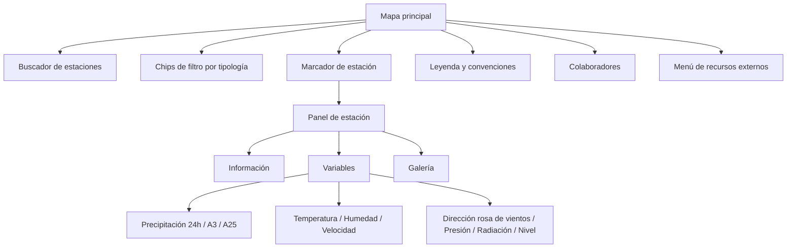

# Rediseño Geoportal SIMAC — Plan y brief para Figma Make

> **Qué es este documento.** Brief autónomo y completo para rediseñar el **Geoportal SIMAC** (https://cdiac.manizales.unal.edu.co/geoportal-simac/). Contiene todo el contexto necesario para que **Figma Make** (o cualquier herramienta de diseño asistido) entienda: qué es el producto, qué funcionalidades existen hoy, qué debe conservarse, la dirección visual propuesta, la especificación de cada pantalla con sus estados, datos de ejemplo reales y prompts listos para pegar.
>
> Documento complementario con el detalle técnico (API, WebSocket, lógica): `plans/contexto-geoportal-simac.md`.

---

## 0. Cómo usar este documento con Figma Make

1. Pega primero el **Prompt base** (§15.1) — define el producto, el estilo y las reglas globales.
2. Luego pega, en orden, los **prompts por pantalla** (§15.2 a §15.9). Cada uno es autocontenido.
3. Usa los **datos de ejemplo** (§10) para que los prototipos muestren información realista (nombres, cifras, municipios en español).
4. Usa la **matriz de conservación** (§14) como checklist de aceptación: toda funcionalidad de la columna "Existente" debe tener un lugar visible en el rediseño.
5. Idioma de la interfaz: **español** (Colombia). Moneda/formato numérico: punto decimal, separador de miles opcional (ej. `1 234,5` no; usar `1234.5` como la app actual).
6. Tamaños objetivo de lienzo: **desktop 1440×900**, **tablet 1024×768**, **móvil 390×844**.

---

## 1. Resumen del producto

**Geoportal SIMAC** es una aplicación web pública del **CDIAC** (Centro de Datos e Indicadores Ambientales de Caldas — Universidad Nacional de Colombia, sede Manizales) que muestra en un **mapa interactivo** el estado de las estaciones de monitoreo ambiental del **SIMAC** (Sistema Integrado de Monitoreo Ambiental de Caldas).

Capacidades actuales (todas deben conservarse):

- **Mapa a pantalla completa** con la red de estaciones georreferenciadas (159 estaciones, 82 con datos en vivo).
- **Filtros por tipología**: hidrometeorológicas (79), meteorológicas no telemétricas/"comunitarias" (50), freatrimétricas/aguas subterráneas (12), calidad del aire (8), acelerográficas/sismológicas (10).
- **Actualización en tiempo real cada 5 minutos** (WebSocket): cada marcador cambia de icono según el clima observado (día/noche, despejado, nublado, lluvia) y su estado de conexión (en línea, parcial, fuera de servicio, sin conexión).
- **Ficha de estación** al hacer clic: información administrativa, **8 variables monitoreadas** con gráficas de las últimas 24 h y estadísticas, **indicadores de precipitación A3 (72 h) y A25 (24 días)**, **galería** de fotos y **hoja de vida** en PDF.
- **Buscador de estaciones** por nombre.
- **Convenciones (leyenda)** de todos los iconos y **colaboradores** (10 entidades aliadas).
- **Accesos externos**: reporte meteorológico, IDEA, CDIAC, Facebook, Twitter/X, formulario de contacto.

---

## 2. Usuarios y casos de uso

| Usuario | Necesidad principal |
|---|---|
| Ciudadanía de Manizales/Caldas | "¿Está lloviendo ahora? ¿Qué tan alto está el río?" — consulta rápida desde el celular |
| Gestión del riesgo (Alcaldía, Corpocaldas, UNGRD) | Seguimiento de precipitación acumulada (A3/A25) y niveles de ríos para alertas |
| Investigadores y técnicos CDIAC/IDEA | Series de 24 h por variable, coordenadas, hojas de vida, metadatos de red/estación |
| Periodistas y comunicadores | Estado actual de la red, capturas de gráficas, datos de contacto |
| Aliados institucionales | Visibilidad de la red colaborativa (créditos por entidad) |

**Jobs-to-be-done frecuentes:**
1. Ver de un vistazo el estado general de la red (¿cuántas estaciones en línea? ¿dónde llueve?).
2. Encontrar una estación concreta y ver sus datos actuales.
3. Revisar el comportamiento de las últimas 24 h de una variable (temperatura, nivel, humedad…).
4. Consultar acumulados de lluvia para riesgo de deslizamiento/creciente.
5. Obtener la hoja de vida o fotografiar la estación (trámites, inventario).
6. Navegar a otros sistemas del CDIAC.

---

## 3. Objetivos y principios del rediseño

**Objetivo:** modernizar la interfaz manteniendo el 100 % de las funcionalidades, mejorando legibilidad, jerarquía visual y uso en móvil; eliminando la mezcla de frameworks (hoy convive ant-design + Bootstrap 5 + BootstrapVue) y la estética de "panel antiguo".

**Principios de diseño:**

1. **Mapa primero, decisiones rápidas.** El mapa es el lienzo; todo lo demás son capas de información que aparecen y desaparecen sin recargar contexto.
2. **Estado en vivo siempre visible.** Dónde y cuándo se actualizó por última vez ("Actualizado 12:45 · hace 3 min") debe estar en la barra superior y en cada estación.
3. **Color con significado, no decorativo.** Un color por tipología de estación; un color por estado operativo. Nunca reinventar: la leyenda es el contrato.
4. **Densidad con calma.** Muchos datos (288 registros, 8 variables), pero con capas progresivas: resumen → detalle → dato crudo/exportable.
5. **Consistencia de un solo sistema.** Un único lenguaje visual (tokens §6): sin apariencia de Bootstrap ni de ant-design.
6. **Accesible y en español.** Foco visible, navegación por teclado, contraste AA, textos en español claro con los términos técnicos del dominio.

**No objetivos (fuera de alcance):** no cambiar la lógica de negocio ni las APIs; no añadir login ni edición de datos; no rediseñar el backend.

---

## 4. Alcance de pantallas (entregables del rediseño)

| # | Pantalla / superficie | Prioridad |
|---|---|---|
| S1 | Vista principal del mapa (desktop) | Alta |
| S2 | Panel de estación — pestaña **Información** | Alta |
| S3 | Panel de estación — pestaña **Variables** (8 variables + Precipitación A1/A3/A25) | Alta |
| S4 | Panel de estación — pestaña **Galería** | Media |
| S5 | Panel de **Capas y convenciones** (leyenda) | Alta |
| S6 | **Buscador de estaciones** (con estados de conexión) | Alta |
| S7 | Modal **Colaboradores** + menú de **recursos externos** | Media |
| S8 | Estados globales: carga, error, sin datos, sin conexión, tiempo real | Alta |
| S9 | **Responsive móvil** (mapa + panel como bottom sheet) | Alta |
| S10 | Bienvenida/onboarding breve (opcional, primera visita) | Baja |

---

## 5. Arquitectura de información del rediseño



Flujo principal: el usuario entra → ve la red completa en vivo → filtra o busca → abre 1..n estaciones en el panel lateral → consulta variables/indicadores → exporta o comparte (hoja de vida, gráfica).

---

## 6. Dirección visual (design system propuesto)

### 6.1 Concepto

**"Sala de monitoreo clara":** una interfaz de instrumentos, luminosa y precisa. Superficies blancas translúcidas sobre el mapa (glass suave), datos con números tabulares, microestado "en vivo" siempre presente (punto pulsante), y un solo color de marca — el **naranja SIMAC** — reservado para acciones y énfasis. Nada de sombras duras, gradientes metálicos ni glass exagerado; estética tipo producto meteorológico moderno (parcialmente inspirada en paneles tipo Meteostat/Windy pero con la identidad CDIAC/SIMAC).

### 6.2 Tokens de color

**Marca y neutros**

| Token | Hex | Uso |
|---|---|---|
| `brand/500` | `#E96729` | Color SIMAC/CDIAC: botones primarios, enlaces activos, selección |
| `brand/600` | `#D2571C` | Hover de acciones primarias |
| `brand/50` | `#FEF1EA` | Fondos sutiles de énfasis |
| `ink/900` | `#0F172A` | Texto principal, títulos |
| `ink/600` | `#475569` | Texto secundario |
| `ink/400` | `#94A3B8` | Texto terciario, metadatos |
| `surface/0` | `#FFFFFF` | Superficies de panel/tarjeta |
| `canvas` | `#F1F5F9` | Fondo de página detrás del mapa (fallback) |
| `line` | `#E2E8F0` | Bordes y divisores |
| `map-overlay` | `rgba(255,255,255,0.86)` + blur 12px | Paneles flotantes sobre el mapa |

**Colores por tipología de estación** (para chips, badges, marcadores y leyenda — reemplazan a los iconos ambiguos actuales):

| Tipología | Nombre en UI | Color | Hex |
|---|---|---|---|
| Hidrometeorológica (+ Meteorológica) | Hidrometeorológicas | Azul | `#0EA5E9` |
| Meteorológica no telemétrica | Comunitarias | Violeta | `#8B5CF6` |
| Freatrimétrica / Aguas freáticas | Aguas subterráneas | Verde azulado | `#14B8A6` |
| Calidad del aire | Calidad del aire | Verde | `#22C55E` |
| Acelerográfica / Sismológica | Acelerográficas | Naranja intenso | `#F97316` |

**Colores de estado operativo** (badges y borde de marcador):

| Estado | Color | Hex | Icono propuesto |
|---|---|---|---|
| En vivo (dato < 15 min) | Verde | `#16A34A` | punto pulsante |
| Funcionamiento parcial | Ámbar | `#F59E0B` | semicírculo de advertencia |
| Temporalmente fuera de servicio | Rojo | `#DC2626` | señal de alerta |
| Sin conexión / sin datos | Gris | `#64748B` | icono de desconexión |

**Semántica de variables (gráficas y KPIs):**

| Variable | Hex | Unidad |
|---|---|---|
| Precipitación | `#3B82F6` | mm |
| Temperatura | `#EF4444` | °C |
| Humedad relativa | `#22C55E` | % |
| Velocidad del viento | `#A855F7` | m/s |
| Dirección del viento | `#6366F1` | ° (rosa polar) |
| Presión barométrica | `#F97316` | mmHg |
| Radiación solar | `#EAB308` | W/m² |
| Nivel (río/pozo) | `#4F46E5` | cm |

### 6.3 Tipografía

- **Familia:** `Inter` (fallback `system-ui, -apple-system, "Segoe UI", Roboto`). Números de datos: `font-variant-numeric: tabular-nums`.
- **Escala:**
  | Rol | Tamaño / interlínea | Peso |
  |---|---|---|
  | Display (nombre de estación en panel) | 24/30 | 700 |
  | H1 (título de vista) | 20/28 | 700 |
  | H2 (secciones, cabeceras de tarjeta) | 16/24 | 600 |
  | Body | 14/20 | 400 |
  | Label / metadato | 12/16 | 500 |
  | KPI numérico | 28/32 | 700 (tabular) |
  | Micro (badges, ejes) | 11/14 | 600 |

### 6.4 Espaciado, radios y sombras

- Escala de espaciado: **4 / 8 / 12 / 16 / 24 / 32 / 48** px.
- Radios: `sm 8px` (badges y chips), `md 12px` (inputs, botones), `lg 16px` (tarjetas y paneles), `full` (avatar/estado).
- Sombras: `shadow/1 0 1px 2px rgba(15,23,42,.06)`, `shadow/2 0 8px 24px rgba(15,23,42,.12)` para paneles flotantes; nada de sombras internas ("inset") como hoy.
- Iconografía: set de línea (Lucide/Phosphor), grosor 1.75–2 px, tamaños 16/20/24; **iconos meteorológicos propios** (10 estados de §8.1) como badges circulares de 36–40 px para los marcadores del mapa.

### 6.5 Gráficas (reemplazan a Highcharts visualmente)

- Tarjeta de gráfica con: título de variable, selector de rango (fijo: "Últimas 24 h"), botón **Pantalla completa**, botón **Exportar** (menú: PNG, SVG, JPEG, PDF, Imprimir) y menú "Fuente: IDEA · actualizado a las HH:MM".
- Área/lineal con gradiente suave del color de la variable, grilla horizontal tenue (`#F1F5F9`), ejes con `ink/400`, tooltip con fecha/hora y valor con unidad, zoom por arrastre en el eje Y.
- Serie de precipitación: área acumulada (azul) + barras discretizadas (azul oscuro) en la misma gráfica, con leyenda clara.
- Rosa de vientos: polar con 16 sectores, dos series (Jornada diurna `#6366F1`, Jornada nocturna `#0F172A`), frecuencia relativa %.
- Estados de gráfica: cargando (skeleton), sin datos ("Esta variable no reporta datos para esta estación"), error (reintentar).

### 6.6 Movimiento

- Duraciones 150–250 ms, curva `ease-out`.
- Panel de estación: desliza desde la derecha (o bottom sheet en móvil), sin recargar el mapa.
- Punto "en vivo": pulso suave cada 2 s; **flash breve del marcador** cuando llega el dato de 5 minutos.
- Sin gifs de carga a pantalla completa: usar *skeletons* y *toasts* discretos.

### 6.7 Tema

- Solo **tema claro** en el MVP del rediseño (el mapa ya es claro). Dejar preparado el token `surface/0` para un futuro modo oscuro; no diseñarlo ahora.

---

## 7. Layout general (desktop 1440×900)

```
┌────────────────────────────────────────────────────────────────────────────────┐
│ [🔶 SIMAC]  Geoportal SIMAC           [🔍 Buscar estación...]   ● En vivo 12:45 │  Topbar 64 px
│             Monitoreo ambiental de Caldas          [Capas] [Colaboradores] [⋮] │
├────────────────────────────────────────────────────────────────────────────────┤
│ ┌─────────────── chips de tipología (scroll horizontal en móvil) ────────────┐ │
│ │ [Todas 159] [Hidrometeo 79] [Comunitarias 50] [Aguas subterráneas 12]      │ │
│ │ [Calidad del aire 8] [Acelerográficas 10]                                  │ │
│ └────────────────────────────────────────────────────────────────────────────┘ │
│                                  ┌──────────────────────────────────────────┐  │
│         🟠🔵🔵🟢🟣 (marcadores)    │  PANEL DE ESTACIÓN (480 px, flotante)    │  │
│                                  │  Río Tapias · Hidrometeorológica · ●live │  │
│                                  │  [Información] [Variables] [Galería]      │  │
│                                  │  ──────────────────────────────────────  │  │
│                                  │  KPI cards + gráficas + metadatos         │  │
│                                  └──────────────────────────────────────────┘  │
│  [Convenciones] [Colaboradores]                    lat/lng GMS · escala · zoom  │
└────────────────────────────────────────────────────────────────────────────────┘
```

Reglas de layout:

- **Topbar** fija, 64 px, `map-overlay` translúcido con blur; siempre visible.
- **Chips de tipología**: fila flotante superior izquierda, 12 px bajo la topbar; cada chip = icono circular con el color de la tipología + nombre + **contador**; estado apagado = contorno gris, sin relleno. Incluye chip "Todas" (muestra el total). Comportamiento conservado: si todas están activas y se elige una → solo esa; toggles de lo contrario.
- **Mapa**: OSM como base; capa de límites municipales de Caldas en estilo tenue (gris azulado `#CBD5E1`, relleno 8 % de opacidad); marcadores siempre encima.
- **Panel de estación**: tarjeta flotante a la derecha (480 px, `map-overlay`, radio `lg`, `shadow/2`), ocupa el alto disponible con scroll interno; **se pueden abrir varias estaciones a la vez** — se apilan como tarjetas plegables con cabecera pegajosa (nombre + estado + cerrar).
- **Esquina inferior izquierda**: accesos "Convenciones" y "Colaboradores" (botones secundarios). Esquina inferior derecha: chip de coordenadas GMS del cursor + escala métrica/imperial + controles de zoom (verticales).
- Atribución OSM obligatoria, discreta, esquina inferior derecha.

---

## 8. Comportamiento dinámico (reglas que el prototipo debe mostrar)

### 8.1 Estado del marcador ← datos en vivo (cada 5 minutos)

Cada marcador usa un **badge circular** con el color de su tipología y un **icono de estado meteorológico/conexión**:

| # | Estado | Cuándo | Visual |
|---|---|---|---|
| 1 | Día despejado | día (06:00–18:00), sin lluvia, temp > 24 °C | sol |
| 2 | Día parcialmente nublado | día, sin lluvia, 21–24 °C | sol con nube |
| 3 | Día nublado | día, sin lluvia, ≤ 21 °C | nube |
| 4 | Día con lluvia | día, con lluvia y ≤ 21 °C | nube con gotas |
| 5 | Noche nublada | noche (18:00–06:00), sin lluvia | luna con nube |
| 6 | Noche con lluvia | noche, con lluvia | luna con gotas |
| 7 | Comunitarias (no telemétricas) | siempre para estaciones sin telemetría | icono de comunidad |
| 8 | Funcionamiento parcial | 1–3 de las últimas 4 muestras con datos nulos | badge ámbar |
| 9 | Temporalmente fuera de servicio | las 4 muestras nulas | badge rojo |
| 10 | Sin conexión | sin datos / no aparece en el flujo en vivo | badge gris |

### 8.2 Tiempo real (visible en UI)

- Un evento cada **5 minutos** actualiza los marcadores; la topbar muestra **"En vivo · Actualizado HH:MM"** con punto pulsante y hace un *flash* suave en los marcadores que cambian.
- Si la conexión se pierde: la topbar cambia a **"Sin conexión · último dato HH:MM"** (gris) y ofrece "Reintentar".
- Hover sobre marcador → mini-tarjeta flotante: nombre, tipología, último dato (temp/precip.), última transmisión, estado.

### 8.3 Histórico en el panel (lo que se muestra al abrir una estación)

- **Resumen de encabezado:** nombre, chips de tipología/red, estado de conexión, "Última transmisión: 14:37:12" y hace cuánto.
- **Información:** Código SIMAC, Tipo de estación, Red, Coordenadas (GMS + copiar), Altitud m s. n. m., Ubicación, Municipio, Cuenca, Sub‑cuenca, Tara, Propietario, Activa desde, enlaces **Aforo** y **Hoja de vida** (o texto "Estación sin hoja de vida").
- **Variables:** en cada variable, fila de KPIs + gráfica. Metadatos por variable: **% Datos recuperados** y **Última transmisión** (van como línea de metadatos, no como texto repetido en cada tab).
  - Precipitación: sub‑vistas **24 h (A1)**, **Indicador A3 (72 h)**, **Indicador A25 (24 días, máx/mín)**.
  - Dirección: rosa de vientos diurna/nocturna + % de datos recuperados por jornada.
  - Nivel: muestra la **Tara** (ej. "537 cm") junto al KPI actual.
- Regla: **las pestañas de variables sin datos se ocultan** (no se muestran vacías); si no hay ninguna variable, mostrar estado "Estación sin datos telemétricos" con acceso solo a Información y Galería.

---

## 9. Especificación pantalla por pantalla

### S1 · Vista principal del mapa

**Contenido:** topbar (§7) + chips de tipología + mapa + marcadores + panel(es) de estación + acciones inferiores + atribución.

**Componentes y estados:**

| Componente | Variantes / estados |
|---|---|
| Topbar | normal · con panel abierto (el buscador se comprime) · móvil (menú "⋮") |
| Chip de tipología | activo (relleno color + ✓) · inactivo (contorno) · solo-activa · "Todas" |
| Marcador | por tipología × por estado (§8.1) · hover · seleccionado (anillo + escala 1.15) · "actualizándose" (pulso) |
| Mini-tarjeta de hover | con datos · sin datos |
| Coordenadas | lat/lng GMS en vivo |
| Modos de apertura | 0 estaciones · 1 estación · varias (pilas) |

**Interacciones:**
- Clic en marcador → abre la estación en el panel (si ya está abierta, la enfoca).
- Esc → cierra la estación enfocada; Esc de nuevo → cierra el panel.
- Teclado: `Tab` navega topbar/chips/marcadores (los marcadores deben ser focusables), `Enter` abre.

### S2 · Panel de estación — Información

- Cabecera pegajosa: nombre (Display), chips tipología + red, badge de estado, "Última transmisión", botones: **cerrar (×)**, **copiar enlace** (nuevo, opcional).
- Cuerpo: lista de definición en **2 columnas** (desktop) / 1 columna (móvil); los campos vacíos se omiten.
- Acciones destacadas: botón **"Hoja de vida (PDF)"** (o aviso atenuado "Estación sin hoja de vida"), botón **"Aforo"** si aplica, y enlace "Más información en CDIAC".
- Pie: "Fuente: IDEA–CDIAC · Universidad Nacional de Colombia".

### S3 · Panel de estación — Variables

Estructura propuesta (reemplaza a las pestañas anidadas actuales por una **fila de variables en chips/pills** + contenido único):

```
[ Precipitación ] [ Temperatura ] [ Humedad ] [ Viento ] [ Dirección ] [ Presión ] [ Radiación ] [ Nivel ]
────────────────────────────────────────────────────────────
 Variables monitoreadas                     ● Datos recuperados: 97.9 %
┌────────────┬────────────┬────────────┬────────────┐
│ Actual     │ Máx (24h)  │ Media (24h)│ Mín (24h)  │   ← KPI cards con unidad y color de la variable
│ 31.5 °C    │ 33.3 °C    │ 31.9 °C    │ 28.1 °C    │
└────────────┴────────────┴────────────┴────────────┘
┌────────────────────────── Gráfica (área, 24 h) ─────────────┐
│  [⤢ Pantalla completa] [⤓ Exportar]      Fuente: IDEA       │
└──────────────────────────────────────────────────────────────┘
```

- **Viento** agrupa Velocidad y Dirección (dos secciones apiladas) para reducir el número de chips.
- **Precipitación** muestra 3 sub‑vistas conmutables: `24 h (A1)` · `Indicador A3` · `Indicador A25`; cada una con KPIs propios (A25 además: valor máximo y mínimo del periodo).
- **Nivel** incluye la Tara junto al KPI y en el tooltip.
- Estados por variable: con datos · sin datos (mensaje con icono) · cargando (skeleton) · error (reintentar).

### S4 · Panel de estación — Galería

- Si hay 1–2 imágenes: carrusel con flechas, contador "1/2", click → **lightbox** (fondo oscuro 80 %, imagen 90 %, cerrar con Esc).
- Fallback: imagen `imagen_no_disponible` con leyenda "Imagen no disponible".
- Si no hay imágenes, la pestaña no se muestra (se conserva la regla actual).

### S5 · Capas y convenciones (reemplazo del modal "Convenciones")

- **Drawer** derecho (400 px) o modal centrado en móvil; título "Leyenda y convenciones".
- Sección 1 — **Tipos de estación**: tabla de 5 filas (muestra de marcador, nombre, descripción en una línea, contador).
- Sección 2 — **Estados de las estaciones**: 4 badges (En vivo, Parcial, Fuera de servicio, Sin conexión) con definición.
- Sección 3 — **Estado del tiempo observado** (solo hidrometeorológicas/comunitarias): los 6 iconos día/noche con su regla (texto corto: "sin lluvia y > 24 °C").
- Sección 4 — **Tipologías de mapa**: nota sobre la capa de límites municipales.
- Cierre con `Esc` y botón "Listo".

### S6 · Buscador de estaciones

- Input en topbar con icono de búsqueda; al enfocar se abre un **popover de resultados** (480 px) con búsqueda incremental sobre el nombre, municipio y código.
- Cada resultado: badge de tipología + nombre (bold) + "Municipio · Red" (secundario) + badge de estado a la derecha + "Últ. dato HH:MM".
- Navegación con ↑/↓ + Enter; sección "Recientes" (últimas 5 consultadas, almacenadas local) — mejora propuesta.
- Estado vacío: "No se encontraron estaciones para «…»" con sugerencia de revisar ortografía.
- Al elegir: el mapa vuela al marcador (zoom 15), lo resalta y abre el panel.

### S7 · Colaboradores y recursos externos

- **Colaboradores**: modal centrado, título "Con esta red colaboran", grid 2×5 (desktop) de tarjetas de logo con nombre y flecha "abrir en nueva pestaña"; hover eleva la tarjeta. Entidades: Universidad Nacional de Colombia, Corpocaldas, Alcaldía de Manizales, Gobernación de Caldas, Aguas de Manizales, CHEC, EMAS/Veolia, GAIA–FROAC, GTA–Ingeniería Hidráulica (IDEA), Gestión del Riesgo de Manizales.
- **Menú "⋮" de recursos externos**: dropdown con "Reporte meteorológico", "Geoportal IDEA", "Indicadores CDIAC", "Facebook SIMAC", "Twitter/X SIMAC", "Contacto (formulario)" — cada uno con icono y "abre en pestaña nueva".

### S8 · Estados globales

| Estado | Diseño |
|---|---|
| Carga inicial | Topbar + mapa con **skeletons de chips**; en el mapa se superpone un pill centrado "Cargando estaciones… 3/5" (en vez del gif gigante) |
| Error de listas | Toast persistente abajo: "No se pudieron cargar las estaciones. Reintentar" |
| Error al abrir estación | Dentro del panel: tarjeta de error con **Reintentar** y "Contacto" (en vez de modal 500 global) |
| Sin datos de una variable | Mensaje dentro de la sección |
| Estación sin datos telemétricos | Banner gris en el panel: "Esta estación no reporta datos automáticos" |
| Sin conexión al tiempo real | Topbar en estado gris "Sin conexión · Reintentar" |

### S9 · Responsive móvil (390×844)

- Topbar compacta: logo + título corto ("SIMAC") + `🔍` (icono que abre overlay de búsqueda a pantalla completa) + `●` estado.
- Chips de tipología: fila con **scroll horizontal** y sombra en el borde.
- Panel de estación: **bottom sheet** (85 % alto, arrastrable, esquinas superiores redondeadas, "handle").
- Panel de variables: chips de variables también con scroll horizontal; KPIs en grid 2×2; gráficas a ancho completo; exportación y pantalla completa se conservan.
- Leyenda y colaboradores: hojas a pantalla completa con botón "Listo".
- Objetivo táctil: mínimo 44×44 px en todos los controles.

### S10 · Bienvenida (opcional, primera visita)

- Toast/tarjeta discreta en la primera visita: "Toca cualquier estación para ver sus datos en vivo. Usa los chips para filtrar por tipo." con "Entendido". Recordar con `localStorage`.

---

## 10. Datos de ejemplo (usar en los prototipos)

### Estaciones (nombres reales de la red)

| Estación | idStation | Tipología | Red | Municipio | Altitud | Coordenadas (lat, lon) | Propietario | Desde | Tara |
|---|---|---|---|---|---|---|---|---|---|
| Río Tapias | 63 | Hidrometeorológica | Caldas | Neira | 825 m | 5.222675, −75.6377417 | Corpocaldas | 2013‑07‑18 | 537 cm |
| Río Supía – San Cayetano | 292 | Hidrometeorológica | Caldas | Supía | 1215 m | 5.4546111, −75.6677778 | Corpocaldas | 2023‑11‑21 | 850 cm |
| Q. El Guamo – CDI San Sebastián | 155 | Hidrometeorológica | Caldas | Manizales | — | 5.0869, −75.487 | — | — | — |
| Q. Guayabal – Recinto del Pensamiento | 209 | Hidrometeorológica | Caldas | Manizales | — | 5.0414306, −75.4456806 | — | — | — |
| Q. La Francia – Los Puentes | 153 | Hidrometeorológica | Caldas | Manizales | — | 5.0622167, −75.5461472 | — | — | — |
| Río Chinchiná – Bosque Popular | 161 | Hidrometeorológica | Caldas | Manizales | — | 5.0317778, −75.4779139 | — | — | — |
| Filadelfia Bomberos – JDEGER | 255 | Meteorológica no telemétrica (Comunitaria) | Estaciones Comunitarias | Filadelfia | 1593 m | 5.2952194, −75.5613333 | JDEGER | 2019‑12‑06 | — |

Código SIMAC de ejemplo: `174860302002` (Río Tapias), `172720401001` (Filadelfia Bomberos).

### Valores reales para gráficas y KPIs

- **Río Tapias (24 h, 288 registros cada 5 min):**
  - Temperatura: actual `31.5 °C` · máx `33.3` · media `31.9` · mín `28.1` · % datos `100 %`.
  - Nivel: actual `219.4 cm` · máx `220.8` · media `219.0` · mín `217.2` · Tara `537 cm`.
  - Precipitación 24 h: actual `0 mm` · acumulada (A1) `0 mm`.
- **Indicador A25 (Río Tapias, 25 días):** máximo `144.0 mm` · mínimo `9.2 mm`; serie diaria con picos: 2026‑10‑05 `61.4 mm`, 2026‑10‑04 `12.2 mm`, 2026‑09‑26 `14.0 mm`; acumulado final `144.0 mm`.
- **Indicador A3 (Río Tapias, 72 h):** serie 5‑min con lluvia el 2026‑10‑12 entre 15:31 y 16:46 (picos 2.2 mm/5 min), resto 0.
- **Río Supía (24 h):** temperatura `33.8 °C`, nivel `264.7 cm`.
- **Ejemplo "sin datos":** Filadelfia Bomberos — sin datos → panel solo con Información y Galería (hoja de vida: `/corpocaldas/MarquetaliaAlcaldia.pdf` es de ejemplo; usar rutas reales solo si aplica).

### Textos de la interfaz (copy en español)

Títulos: "Geoportal SIMAC", "Monitoreo ambiental de Caldas", "Leyenda y convenciones", "Con esta red colaboran".
Etiquetas de datos: "Código", "Tipo de estación", "Red", "Latitud", "Longitud", "Altitud", "Ubicación", "Municipio", "Cuenca", "Sub‑cuenca", "Tara", "Propietario", "Activa desde", "Detalle", "Hoja de vida", "Aforo", "Estación sin hoja de vida".
Variables: "Precipitación", "Precipitación actual", "Precipitación acumulada (A1)", "Indicador A3", "Indicador A25", "Temperatura del aire", "Humedad relativa", "Velocidad del viento", "Dirección del viento", "Presión barométrica", "Radiación solar", "Nivel", "Nivel máximo (últimas 24 h)", "Nivel medio (últimas 24 h)", "Nivel mínimo (últimas 24 h)", "Valor máximo del indicador A25", "Valor mínimo del indicador A25", "Datos recuperados", "Última transmisión", "Jornada diurna", "Jornada nocturna".
Estados: "En vivo", "Actualizado 12:45", "Sin conexión", "Funcionamiento parcial", "Temporalmente fuera de servicio", "Estación sin datos telemétricos".
Acciones: "Buscar estación…", "Pantalla completa", "Exportar", "Reintentar", "Listo", "Cerrar", "Abrir en nueva pestaña".
Errores: "No se pudieron cargar las estaciones", "No se encontraron estaciones para «…»", "Esta variable no reporta datos para esta estación".

---

## 11. Inventario de componentes (para el archivo de Figma)

| Componente | Variantes | Estados |
|---|---|---|
| `Topbar` | desktop / móvil | normal · buscador abierto · sin conexión |
| `BrandLogo` (SIMAC + CDIAC) | claro | — |
| `SearchInput` | topbar / overlay móvil | idle · focus · con texto · con resultados · vacío |
| `SearchResultItem` | — | hover · seleccionado · con/sin datos |
| `TypologyChip` | 5 tipologías + "Todas" | activo · inactivo · hover · contador |
| `LiveStatusPill` | — | en vivo (pulso) · actualizando · sin conexión |
| `MapMarker` | 5 colores × 10 iconos de estado | default · hover · seleccionado · actualizándose |
| `MarkerHoverCard` | — | con datos · sin datos |
| `StationPanel` | desktop (lateral) / móvil (sheet) | 1 estación · N estaciones |
| `StationPanelHeader` | — | con estado · sin hoja de vida |
| `TabNav` | 3 pestañas | activa · inactiva · disabled (sin galería) |
| `DefinitionList` | 1/2 columnas | — |
| `VariablePill` | 8 variables | activa · inactiva |
| `KpiCard` | 4 positivas + variante "sin dato" | — |
| `ChartCard` | área · línea · barras+área · polar | cargando · con datos · sin datos · error · fullscreen |
| `MetadataLine` | — | — |
| `StatusBadge` | 4 estados + tipologías | — |
| `Chip/Button` | primary · secondary · ghost · icon | hover · focus · disabled |
| `Drawer` / `Modal` | leyenda · colaboradores · lightbox | — |
| `Toast` | info · error · éxito | con acción "Reintentar" |
| `Skeleton` | chips · panel · gráfica | — |
| `EmptyState` | sin datos · sin resultados · sin conexión | — |

---

## 12. Requisitos de accesibilidad

- Contraste mínimo **AA** (4.5:1 texto, 3:1 componentes); no usar color como único indicador (los estados llevan icono + texto).
- Navegación completa por teclado: topbar → chips → buscador → marcadores (focusables con anillo `brand/500`) → panel → pestañas.
- `Esc` cierra en orden: búsqueda → drawer/modal → estación → panel.
- `alt` descriptivo en imágenes de galería ("Estación Río Tapias, vista general"), `aria-label` en iconos, `role="status"` en el indicador "En vivo", `aria-live="polite"` en toasts.
- Áreas táctiles ≥ 44 px en móvil; `prefers-reduced-motion` desactiva pulsos/transiciones.
- Todo texto en español; `lang="es"`.

---

## 13. Notas de implementación del prototipo (para Figma Make)

- Usar datos mock coherentes con §10; las gráficas pueden ser **estáticas pero creíbles** (series generadas con esos picos).
- Hacer clicable el flujo: chip → filtra marcadores (simular mostrando/ocultando grupos); marcador → panel; pestañas → secciones; "Convenciones" → drawer; "Buscar" → resultados → selección → mapa "vuela" al marcador (basta un cambio de vista).
- Simular el estado "en vivo" con un ciclo: al cabo de ~5 s cambiar un marcador de "nublado" a "lluvia" y mostrar el flash + actualizar la hora de la topbar (demuestra el tiempo real).
- No usar estilos de Bootstrap/ant-design; seguir los tokens de §6.
- Iconos meteorológicos: dibujarlos simples (sol, sol+nube, nube, nube+lluvia, luna+nube, luna+lluvia) dentro de un badge circular con el color de la tipología.

---

## 14. Matriz de conservación de funcionalidades (criterio de aceptación)

| # | Funcionalidad existente (v1) | Dónde vive en el rediseño |
|---|---|---|
| 1 | Mapa pantalla completa OSM, centro [5.29,−75.2], zoom 10 | S1 |
| 2 | Capa de límites municipales (GeoJSON) | S1 (misma capa, estilo tenue) |
| 3 | Marcadores por tipología con tooltip de nombre | S1 (`MapMarker` + `MarkerHoverCard`) |
| 4 | Filtros de capas (5 botones) | S1 (`TypologyChip` con contadores) |
| 5 | Iconos dinámicos por clima y conexión (10 estados) | §8.1 + S1 |
| 6 | Actualización en vivo cada 5 min | §8.2 + `LiveStatusPill` |
| 7 | Buscador de estaciones con zoom al resultado | S6 |
| 8 | Coordenadas GMS en vivo + escala + zoom | S1 (esquina inferior) |
| 9 | Panel lateral de estación; varias a la vez; cierre individual y total | S2–S4 (tarjetas apiladas) |
| 10 | Pestañas Información / Variables / Galería | S2–S4 |
| 11 | Ficha completa (código, red, cuenca, tara, propietario, etc.) | S2 (`DefinitionList`) |
| 12 | Hoja de vida PDF y Aforo | S2 (acciones) |
| 13 | Variables: Precipitación, Temperatura, Humedad, Velocidad, Dirección, Presión, Radiación, Nivel | S3 (`VariablePill`) |
| 14 | Precipitación 24 h (A1) + acumulada | S3 (sub‑vista `24 h (A1)`) |
| 15 | Indicador A3 (72 h) | S3 (sub‑vista) |
| 16 | Indicador A25 (24 días) con máx/mín | S3 (sub‑vista) |
| 17 | Rosa de vientos diurna/nocturna (16 sectores) | S3 (variable Dirección/Viento) |
| 18 | Nivel con Tara y máx/media/mín 24 h | S3 (variable Nivel) |
| 19 | % Datos recuperados y Última transmisión por variable | S3 (`MetadataLine`) |
| 20 | Zoom, exportación (PNG/SVG/JPEG/PDF/imprimir) y pantalla completa en gráficas | S3 (`ChartCard`) |
| 21 | Galería de 2 imágenes con fallback | S4 + lightbox |
| 22 | Modal de Convenciones | S5 (drawer con secciones) |
| 23 | Modal de Colaboradores (10 entidades) | S7 |
| 24 | Menú de recursos externos (7 accesos) | S7 (`⋮`) |
| 25 | Estados de carga y error | S8 (skeletons, toasts, inline) |
| 26 | Estaciones sin datos (`[null]`) → sin Variables | S8 + §8.3 |

---

## 15. Prompts listos para Figma Make

### 15.1 Prompt base (pegar primero)

```
Diseña un prototipo web de alta fidelidad para "Geoportal SIMAC", una aplicación pública del
CDIAC (Universidad Nacional de Colombia) que monitorea en un mapa interactivo 159 estaciones
ambientales del departamento de Caldas, Colombia. La interfaz está completa en ESPAÑOL.

Estilo: "sala de monitoreo clara". Mapa a pantalla completa (OpenStreetMap claro) como lienzo,
con superficies flotantes blancas translúcidas (blur 12px, radio 16px, sombra suave). Un único
sistema de diseño propio (NO usar apariencia de Bootstrap ni ant-design). Tipografía Inter con
números tabulares para datos.

Tokens:
- Marca/accento: #E96729 (naranja SIMAC), hover #D2571C, fondo #FEF1EA.
- Texto: #0F172A (títulos), #475569 (secundario), #94A3B8 (terciario). Líneas: #E2E8F0.
- Color por tipología de estación: Hidrometeorológicas #0EA5E9, Comunitarias #8B5CF6,
  Aguas subterráneas #14B8A6, Calidad del aire #22C55E, Acelerográficas #F97316.
- Estados: en vivo #16A34A, parcial #F59E0B, fuera de servicio #DC2626, sin conexión #64748B.
- Espaciado en múltiplos de 4 (4/8/12/16/24/32/48). Radios 8/12/16. Movimiento 150–250ms ease-out.

Estructura global: barra superior de 64px (logo SIMAC, título "Geoportal SIMAC", subtítulo
"Monitoreo ambiental de Caldas", buscador, pill "En vivo · Actualizado 12:45" con punto
pulsante); bajo ella, fila de chips de filtro por tipología con contadores (Todas 159,
Hidrometeo 79, Comunitarias 50, Aguas subterráneas 12, Calidad del aire 8, Acelerográficas 10);
mapa con marcadores circulares (badge de color por tipología con icono de estado del tiempo);
abajo-izquierda botones "Convenciones" y "Colaboradores"; abajo-derecha coordenadas GMS del
cursor, escala y zoom; atribución OSM discreta.

Restricciones: idioma español; accesible (foco visible, contraste AA, áreas táctiles 44px);
no usar gradientes metálicos ni sombras internas; el color comunica tipología y estado.
```

### 15.2 Prompt S1 — Mapa principal

```
Genera la pantalla principal (1440×900) del Geoportal SIMAC según el prompt base.
Debe incluir: topbar; chips de tipología activos; mapa claro con ~25 marcadores distribuidos
(usa nombres reales: Río Tapias, Río Supía - San Cayetano, Q. El Guamo - CDI San Sebastián,
Río Chinchiná - Bosque Popular, Q. La Francia - Los Puentes, Filadelfia Bomberos - JDEGER…);
la mayoría en estado "día nublado"/"día despejado", 2 con lluvia, 1 ámbar "parcial", 1 gris
"sin conexión". Añade una tarjeta de hover sobre un marcador con: nombre, tipología, Última
transmisión 14:37:12, temperatura 31.5 °C, precipitación 0 mm y estado. Muestra también la fila
inferior de acciones y coordenadas.
```

### 15.3 Prompt S2 — Panel de estación (Información)

```
Añade el panel de estación (tarjeta lateral derecha de 480px, blanca translúcida, radio 16,
sombra suave, scroll interno) para la estación "Río Tapias" (Hidrometeorológica, red Caldas,
municipio Neira, altitud 825 m, propietario Corpocaldas, activa desde 2013-07-18, Tara 537 cm,
código SIMAC 174860302002, coordenadas 5° 13' 21.6'' N, 75° 38' 15.9'' W). Cabecera pegajosa con
nombre, chips "Hidrometeorológica" y "Caldas", badge verde "En vivo", texto "Última transmisión
14:37:12 · hace 2 min", y botón cerrar. Pestañas: Información (activa), Variables, Galería.
Cuerpo: lista de definición a 2 columnas con los campos; botones "Hoja de vida (PDF)" y "Aforo".
Estilo limpio, tipografía Inter, etiquetas en #475569 y valores en #0F172A.
```

### 15.4 Prompt S3 — Panel de estación (Variables y gráficas)

```
En el mismo panel, diseña la pestaña "Variables": título "Variables monitoreadas" con chip
"Datos recuperados 100%" a la derecha; fila de pills superiores con las 8 variables
(Precipitación, Temperatura, Humedad, Viento, Dirección, Presión, Radiación, Nivel — activa
"Temperatura"); 4 tarjetas KPI (Actual 31.5 °C, Máx 24h 33.3 °C, Media 31.9 °C, Mín 28.1 °C) con
acento #EF4444; gráfica de área "Temperatura del aire (últimas 24 horas)" con gradiente rojo
suave, grilla tenue, tooltip visible en un punto (14:37 · 32.5 °C), botones "Pantalla completa" y
"Exportar", y línea "Fuente: IDEA · Última transmisión 14:37:12". Debajo de la gráfica, variante
"Precipitación" con sub‑vistas 24h (A1) / Indicador A3 / Indicador A25 y barras + área azules
(usar picos: 61.4 mm el 2026-10-05; máx 144.0 mm, mín 9.2 mm). Incluye también la rosa de vientos
(dirección) con dos series diurna/nocturna.
```

### 15.5 Prompt S4 — Galería

```
Diseña la pestaña "Galería" del panel: carrusel de 2 fotos de estación (placeholder gris con
icono de imagen si no hay foto), flechas, indicador "1/2", y estado lightbox a pantalla completa
(fondo oscuro 80%, imagen centrada, botón cerrar). Mantén el tono claro del panel.
```

### 15.6 Prompt S5 — Leyenda y convenciones

```
Diseña un drawer derecho de 400px titulado "Leyenda y convenciones", con 4 secciones:
1) "Tipos de estación": 5 filas con muestra de marcador circular de color, nombre y contador
   (Hidrometeorológicas 79, Comunitarias 50, Aguas subterráneas 12, Calidad del aire 8,
   Acelerográficas 10).
2) "Estados de las estaciones": badges En vivo / Parcial / Fuera de servicio / Sin conexión con
   una línea de definición.
3) "Estado del tiempo observado": 6 iconos (día despejado >24°, día parcial 21–24°, día nublado
   ≤21°, día con lluvia, noche nublada, noche con lluvia).
4) Nota sobre la capa de límites municipales. Botón "Listo" abajo.
```

### 15.7 Prompt S6 — Buscador

```
Diseña el buscador de estaciones: input en la topbar con lupa y placeholder "Buscar estación…";
al enfocarlo, popover de 480px bajo el input con resultados (badge de tipología, nombre en
negrita, "Neira · Caldas" secundario, badge de estado a la derecha, "Últ. dato 14:37"). Muestra
6 resultados y un estado vacío "No se encontraron estaciones para «xyz»". Navegación con
↑/↓ resaltada en #FEF1EA.
```

### 15.8 Prompt S8 — Estados del sistema

```
Diseña los estados globales: (a) carga inicial con skeletons en chips y pill centrado en el mapa
"Cargando estaciones… 3/5"; (b) toast de error abajo "No se pudieron cargar las estaciones" con
botón "Reintentar"; (c) error dentro del panel de estación (tarjeta con mensaje y Reintentar);
(d) variable sin datos (mensaje con icono); (e) banner gris "Esta estación no reporta datos
automáticos"; (f) topbar en estado "Sin conexión · último dato 14:32 · Reintentar".
```

### 15.9 Prompt S9 — Móvil

```
Adapta todo a móvil (390×844): topbar compacta (logo + "SIMAC" + lupa + punto de estado); chips
de tipología con scroll horizontal; panel de estación como bottom sheet al 85% con handle y
esquinas superiores redondeadas; KPIs en grid 2×2; gráficas a ancho completo con botones de
exportar/pantalla completa; leyenda y colaboradores como pantallas completas con botón "Listo".
```

---

## 16. Anexos

### 16.1 Enlaces externos que el rediseño debe seguir ofreciendo

| Etiqueta | URL |
|---|---|
| Reporte meteorológico IDEA | `http://idea.manizales.unal.edu.co/reporte-meteorologico.html` |
| Geoportal IDEA | `http://idea.manizales.unal.edu.co` |
| Inicio Geoportal SIMAC | `https://cdiac.manizales.unal.edu.co/geoportal-simac` |
| Indicadores CDIAC | `https://cdiac.manizales.unal.edu.co/indicadores/public/index` |
| Facebook SIMAC | `https://www.facebook.com/SIMACUNAL/` |
| Twitter/X SIMAC | `https://twitter.com/simac_unal` |
| Contacto (formulario) | `https://cdiac.manizales.unal.edu.co/gestion-riesgo/web/gestion_riesgo/solicitud_informacion/seleccionar_formulario` |
| Aforo | `https://cdiac.manizales.unal.edu.co/aforo.php` |
| Hoja de vida (PDF) | `https://cdiac.manizales.unal.edu.co/hv{archivo}` |
| Imágenes de galería | `https://cdiac.manizales.unal.edu.co/gestion-riesgo/web/resources/uploads/images/{archivo}` |

### 16.2 Glosario de dominio (mantener términos)

- **A1 / A3 / A25**: acumulados de precipitación — 24 h (calculado), indicador a 72 h y acumulado multi‑día (24 días) respectivamente.
- **Tara**: nivel de referencia (cm) del sensor de nivel del río/pozo.
- **Aforo**: medición de caudal; enlace a documento cuando existe.
- **Hoja de vida**: ficha técnica en PDF de la estación.
- **Datos recuperados**: porcentaje de lecturas válidas del periodo.
- **Jornada diurna/nocturna**: 06:00–18:00 / 18:00–06:00 (hora local).
- **Red**: agrupación administrativa de estaciones (p. ej. "Caldas", "Estaciones Comunitarias").
- **Tipología**: Hidrometeorológica, Meteorológica (no telemétrica = "comunitaria"), Aguas Freáticas, Calidad del aire, Sismológica.

### 16.3 Estructura de referencia de la v1 (para trazabilidad)

Topbar con iconos de enlaces · columna izquierda de 5 capas con iconos que rotan en hover · mapa con buscador, coordenadas, escala y zoom · panel lateral derecho de 35em con acordeón por estación y pestañas Información/Variables/Galería · pestañas anidadas de variables y de indicadores de precipitación · gráficas Highcharts con exportación · modales de convenciones y colaboradores · overlays de carga con GIF y modal de error 500. *(Detalle exhaustivo en `plans/contexto-geoportal-simac.md`.)*
